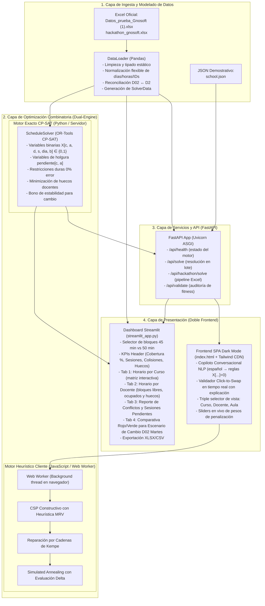

# 🏛️ Arquitectura del Sistema — GnoSoft Timetable AI

Documento técnico descriptivo de la arquitectura de software, modelos matemáticos y patrones de diseño implementados en el repositorio **Hackas** para el **"Reto Gnosoft: Generación Inteligente y Optimización de Horarios Escolares mediante IA"** (Hackathon Colombia 5.0).

---

## 1. Visión General de la Arquitectura

El sistema implementa una **Arquitectura Híbrida Multi-Capa con Motor de Optimización Desacoplado y Doble Interfaz de Usuario**:

---

## 2. Descripción de Componentes por Capa

### Capa 1: Ingesta, Limpieza y Reconciliación de Datos (`backend/data_loader.py`)
- **`DataLoader`**:
  - Lee y valida libros Excel con esquemas complejos: `Bloques`, `Cursos`, `Docentes`, `Habilitados`, `Carga`, `Salones`, `Disponibilidad` y `Cambio` (más la hoja informativa `Leeme`).
  - **Tolerancia y normalización de formatos**:
    - Días normalizados canónicamente: `'martes'`, `'MARTES'`, `'mar'` $\rightarrow$ `'Martes'`.
    - Horas de bloque normalizadas a objetos `datetime.time`: cadenas `'07:00'`, horas fraccionarias de Excel o marcas de tiempo.
    - Reconciliación de identificadores: reconcilia variantes con cero y sin cero (ej. `'D02'` en texto de instrucciones o cambios con `'D2'` en las claves primarias de `Docentes`).
  - **Función `aplicar_cambio_disponibilidad(df_disp, df_cambio)`**:
    - Genera un nuevo DataFrame sin mutar la entrada.
    - Agrega columnas de auditoría: `modificado` (booleano) y `motivo_cambio`.
    - Cruza por clave compuesta `(docente_id, dia, bloque_id)`.
  - **Estructura `SolverData`**:
    - Objeto tipado e inmutable con índices enteros, diccionarios de disponibilidad docente completa y listas de salones compatibles filtrados por tipo y capacidad.

---

### Capa 2: Motores de Optimización Combinatoria

#### A. Motor Exacto Servidor (`backend/schedule_solver.py` & `backend/cpsat_solver.py`)
Implementado con **Google OR-Tools CP-SAT (Constraint Programming - Satisfiability)**:

1. **Variables de Decisión**:
   - $X_{c, a, d, s, \text{dia}, b} \in \{0, 1\}$: Asignación del Curso $c$, Asignatura $a$, Docente $d$, Salón $s$ en el Día $\text{dia}$ y Bloque $b$.
   - $\text{pendiente}_{c, a} \in [0, \text{sesiones\_semana}]$: Variable de holgura por requerimiento para garantizar factibilidad matemática y reportar faltantes.

2. **Restricciones Duras (Hard Constraints - 0% de infracciones)**:
   - **No solapamiento de curso:** Máximo 1 sesión por $(c, \text{dia}, b)$.
   - **No solapamiento de docente:** Máximo 1 sesión por $(d, \text{dia}, b)$.
   - **No solapamiento de salón:** Máximo 1 sesión por $(s, \text{dia}, b)$.
   - **Disponibilidad estricta:** $X = 0$ si $\text{disponible}(d, \text{dia}, b) == 0$.
   - **Capacidad y tipo de espacio:** Asignación exclusiva a salones del tipo requerido con $\text{capacidad}(s) \ge \text{estudiantes}(c)$.
   - **Tope de carga docente semanal:** $\sum X \le \text{max\_sesiones\_semana}_d$.
   - **Intensidad horaria con holgura:** $\sum X + \text{pendiente}_{c,a} = \text{sesiones\_semana}_{c,a}$.

3. **Función Objetivo Ponderada (Soft Constraints)**:
   - **Prioridad 1 (Peso $10^6$):** Maximizar sesiones válidas asignadas (minimizar $\text{pendiente}$).
   - **Prioridad 2 (Peso $1\,200$ y $800$):** Penalizar días donde se repita la misma asignatura en un curso y bloques consecutivos.
   - **Prioridad 3 (Peso $400$):** Minimizar horas huecas docentes ($\text{span}_{d,\text{dia}} - \sum \text{activas}_{d,\text{dia}}$).
   - **Prioridad 4 (Bono de estabilidad):** Al re-optimizar tras aplicar la hoja `Cambio` (bloqueo de D02 el martes), otorga bonificación a las clases que conservan su día, bloque y salón del horario base para mover únicamente las sesiones indispensables.

#### B. Motor Heurístico Cliente (`js/engine/`)
Diseñado para responder en milisegundos directamente en el navegador sin depender de conexión a backend:
- **Web Worker (`worker.js`)**: Ejecución en hilo separado para mantener la UI a 60 FPS.
- **CSP Constructivo (`construct.js`)**: Asignación inicial guiada por MRV (Minimum Remaining Values).
- **Cadenas de Kempe (`kempe.js`)**: Intercambio de colores/bloques en grafos bipartitos para resolver conflictos duros de docentes sin alterar la factibilidad de otros cursos.
- **Simulated Annealing (`annealing.js`)**: Enfriamiento exponencial con función de costo delta evaluada incrementalmente.

---

### Capa 3: Capa de Servicios Backend (`backend/main.py`)
- Implementada en **FastAPI** con servidor ASGI **Uvicorn**.
- Modelos validados mediante **Pydantic v2** (`backend/models.py`).
- Endpoints principales:
  - `GET /api/health`: Chequeo de salud del servicio y versión de OR-Tools.
  - `GET /api/sample`: Datos demo estructurados de 6 cursos y 13 docentes.
  - `POST /api/solve`: Endpoint de optimización CP-SAT en tiempo real.
  - `POST /api/validate`: Auditoría de reglas duras y cálculo de fitness de horarios externos.
  - `POST /api/hackathon/solve`: Ejecución del pipeline oficial de la Hackathon Gnosoft (Escenario Base o Escenario Cambio D02).
  - Servidor de estáticos: Sirve directamente la SPA en `/`.

---

### Capa 4: Capa de Presentación e Interacción

#### 1. Dashboard de Jurados (`streamlit_app.py`)
Especializado para la sustentación del reto ante el comité evaluador:
- **KPI Metrics Header**: Tarjetas reactivas de Cobertura %, Sesiones Asignadas, Sesiones Pendientes, Colisiones y Huecos Docentes.
- **Tab 1: Horario por Curso**: Matriz interactiva de bloques horarios configurable (45 min o 50 min) con codificación de color por asignatura.
- **Tab 2: Horario por Docente**: Visualización clara de clases, bloques bloqueados (`⛔ NO DISPONIBLE`), huecos (`⚠️ HUECO`) y bloques libres (`🟢 Libre`).
- **Tab 3: Conflictos y Diagnóstico**: Diagnóstico automático de causa raíz si existen sesiones pendientes (ej. tope semanal de 24h alcanzado por D4 sin apoyo de D6 en inglés).
- **Tab 4: Comparativa de Cambio**: Matriz lado a lado resaltando en **rojo** las clases salientes y en **verde** las clases reubicadas.
- **Exportación**: Descarga en un clic de Excel multipestaña y CSV.

#### 2. Frontend SPA Web (`index.html` + `js/ui/` + `js/ai/`)
- Construido con **Tailwind CSS (Dark Mode)** y JavaScript modular ES6.
- **Copiloto IA Conversacional (`js/ai/nlp.js` y `js/ai/llm.js`)**:
  - Parser NLP en español que traduce intenciones naturales (ej. *"El profesor Carlos Ruiz no puede los viernes en las últimas 2 horas"*) a restricciones matemáticas formales $X[c,m,p,a,d,b] = 0$.
  - Soporte opcional de Google Gemini API para consultas abiertas.
- **Validación Click-to-Swap (`js/engine/explain.js`)**: Permite arrastrar o intercambiar dos celdas con pre-validación de restricciones duras y explicación instantánea en caso de colisión.
