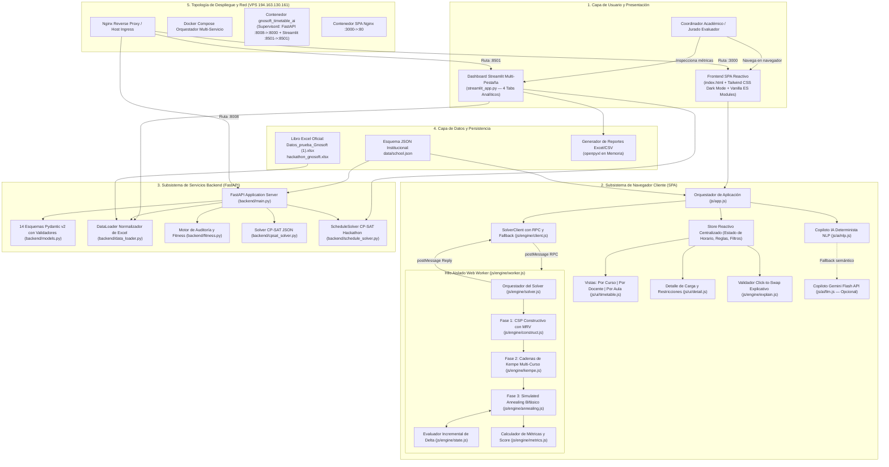
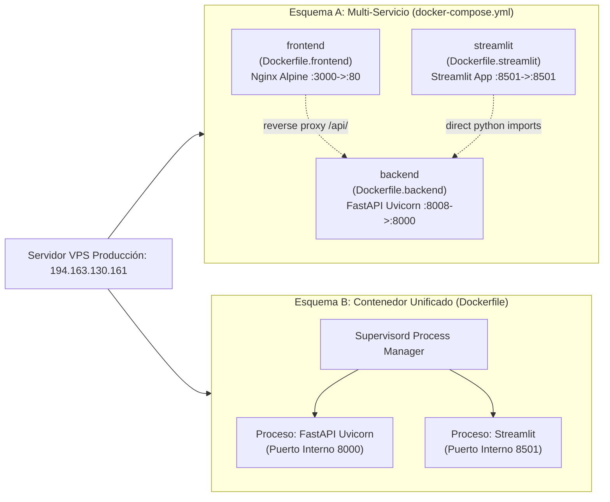

# 🏛️ Arquitectura del Sistema — GnoSoft Timetable AI

**Documento de Arquitectura Técnica y Especificación de Ingeniería**  
**Proyecto**: GnoSoft Timetable AI — Hackas  
**Convocatoria**: Reto Gnosoft: Generación Inteligente y Optimización de Horarios Escolares mediante IA (Hackathon Colombia 5.0)  
**Versión**: 2.0.0 (Publicación de Referencia)  
**Fecha**: Octubre 2026  
**Autores**: Equipo de Ingeniería de Optimización e Inteligencia Artificial Hackas  

---

## 1. Visión General del Sistema y Topología End-to-End

### 1.1 Misión y Filosofía Arquitectónica
El sistema **GnoSoft Timetable AI** está diseñado para resolver el problema clásico de programación horaria escolar (*School Timetabling Problem*, STP) —clasificado formalmente dentro de la clase de complejidad **NP-Hard**— bajo restricciones multifactoriales: disponibilidad de docentes, capacidad física de aulas estándar y laboratorios especializados, curvas de fatiga cognitiva estudiantil, minimización de tiempos muertos (horas huecas) y gestión reactiva de contingencias imprevistas.

Para proporcionar una experiencia interactiva sin fricción a coordinadores académicos y simultáneamente ofrecer garantías matemáticas de optimalidad requeridas en auditorías técnicas, la plataforma adopta una **Arquitectura Híbrida Multi-Capa con Motor de Optimización Desacoplado y Doble Interfaz de Usuario**:

1. **Desacoplamiento Absoluto de Motores**: El usuario dispone de un **Motor Heurístico Cliente (JavaScript / Web Worker)** capaz de explorar espacios de búsqueda masivos ($\sim 10^{35}$ estados posibles) en sub-segundos directamente en el navegador del cliente sin requerir conectividad de red, y de un **Motor Exacto Servidor (Python / Google OR-Tools CP-SAT)** capaz de modelar restricciones lógicas de satisfacibilidad y encontrar soluciones óptimas globales o demostrar formalmente la infactibilidad mediante variables de holgura.
2. **Factibilidad por Construcción (Constructive Invariance)**: En la representación del estado del motor en memoria, las colisiones intrínsecas de un curso consigo mismo y el cumplimiento de las intensidades del plan de estudios se garantizan a nivel de estructura de datos, reduciendo drásticamente la dimensionalidad del espacio infactible.
3. **Ejecución Asíncrona sin Bloqueo de UI (Zero-Jank 60 FPS)**: La interacción del usuario y la animación de componentes visuales corren completamente en el hilo principal del DOM, mientras que el cómputo combinatorio de Simulated Annealing se delega a un Web Worker mediante un protocolo de llamadas remotas asíncronas correlacionadas por identificador de secuencia, con degradación elegante a macro-tareas en caso de entornos restringidos.
4. **Idempotencia, Reconciliación y Resiliencia de Datos**: La capa de ingesta asume que los datos institucionales del mundo real presentan imperfecciones ortográficas, discrepancias tipográficas en identificadores (como la presencia o ausencia de ceros no significativos: `D02` frente a `D2`) y cambios de disponibilidad sobre la marcha. La arquitectura incorpora transformaciones inmutables y normalización previa al paso a cualquier motor.

---

### 1.2 Diagrama Integral de Arquitectura End-to-End



---

## 2. Motor Heurístico Cliente (Frontend SPA / Web Worker)

El motor de cliente está implementado en JavaScript moderno (ES Modules nativos) sin dependencias externas de empaquetado. Provee optimización instantánea en el navegador manteniendo una tasa de refresco constante de 60 cuadros por segundo en la interfaz.

### 2.1 Modelo de Datos del Motor y Espacio de Búsqueda
La especificación matemática del horario escolar en el motor cliente se construye en `js/engine/model.js`. Sea $C$ el conjunto de cursos, $T$ el conjunto de docentes, $S$ el número de franjas horarias semanales ($S = \text{dias} \times \text{bloquesPorDia}$, típicamente $5 \times 6 = 30$), y $L$ el conjunto total de lecciones individuales derivadas del plan de estudio de todos los cursos.

#### Representación de Variables de Decisión
A diferencia del modelado formal clásico por programación lineal entera donde se declaran variables tridimensionales $X_{c, m, p, a, d, b} \in \{0, 1\}$, el motor heurístico utiliza una representación matricial compacta:
$$\text{grid}[c][t] \in \{-1\} \cup \{0, 1, \dots, |L|-1\}$$
donde $c \in [0, |C|-1]$ representa el índice del curso y $t \in [0, S-1]$ el slot temporal. Un valor de $-1$ denota un bloque libre, mientras que un entero $l \ge 0$ hace referencia a la lección inmutable $L[l]$.

Cada lección $l \in L$ encapsula propiedades estáticas inmutables:
- $l.c$: Índice del curso al que pertenece.
- $l.p$: Índice del docente titular asignado.
- $l.s$: Identificador de la asignatura (ej. `'MAT'`, `'CN'`, `'ING'`).
- $l.ty$: Tipo de espacio físico requerido (ej. `'estandar'`, `'lab_ciencias'`, `'lab_sistemas'`).
- $l.heavy$: Booleano que indica alta carga cognitiva.

#### Factibilidad Estructural por Construcción
Esta representación elimina por construcción dos categorías críticas de violaciones duras:
1. **No colisión interna de curso**: Dado que cada celda $\text{grid}[c][t]$ contiene exactamente un elemento, es matemáticamente imposible que un mismo curso tenga asignadas dos materias distintas en el mismo slot temporal.
2. **Cumplimiento estricto de la intensidad horaria**: Para cada curso $c$, el vector fila $\text{grid}[c]$ contiene exactamente el conjunto de lecciones prescritas en su plan de estudio distribuidas entre sus $S$ franjas. Ningún operador de vecindario crea ni destruye lecciones; únicamente permuta sus posiciones.

#### Estado Incremental y Complejidad $O(1)$
En `js/engine/state.js`, la clase `TimetableState` indexa la ocupación de docentes y salones en arreglos lineales de enteros continuos en memoria (`Uint8Array`):
- $\text{tc}[p][t]$: Número de clases asignadas al docente $p$ en el slot $t$. Si $\text{tc}[p][t] > 1$, existe colisión.
- $\text{tyc}[ty][t]$: Demanda del tipo de espacio $ty$ en el slot $t$. Si $\text{tyc}[ty][t] > \text{supply}[ty]$, existe déficit de aulas.

La función `applyMove(C, t1, t2)` ejecuta el intercambio de los slots $t_1$ y $t_2$ sobre un subconjunto de cursos $C$ calculando la variación diferencial de violaciones duras ($\Delta H$) y costo blando ($\Delta S$) en tiempo proporcional a $|C|$, sin requerir el re-escaneo de toda la matriz horaria escolar.

---

### 2.2 Fase 1: CSP Constructivo con Heurística MRV (`construct.js`)
La inicialización del horario no se realiza de forma puramente aleatoria (lo cual generaría un número excesivo de colisiones iniciales), sino mediante un algoritmo constructivo de Satisfacción de Restricciones (CSP) guiado por la heurística **MRV (Minimum Remaining Values)** y *Forward Checking*.

#### Ecuación Explícita de Prioridad MRV
Para cada lección $l \in L$, se calcula un índice dinámico de prioridad $\text{key}[l]$ que pondera el grado de restricción intrínseca del docente, la escasez del aula especializada y el peso cognitivo:

$$\text{key}[l] = \Big(\text{teacherAvail}[p] - \text{teacherLoad}[p]\Big) - 8 \cdot \mathbb{I}_{\text{scarce}}(ty) - 2 \cdot \mathbb{I}_{\text{heavy}}(l) + 3 \cdot \text{rng}()$$

Donde:
- $\text{teacherAvail}[p]$: Cantidad total de slots en los que el docente $p$ está disponible en la semana.
- $\text{teacherLoad}[p]$: Cantidad total de horas que el docente $p$ tiene asignadas en su contrato.
- $(\text{teacherAvail}[p] - \text{teacherLoad}[p])$: Holgura real del docente. Un docente con holgura cero es crítico y debe ubicarse primero.
- $\mathbb{I}_{\text{scarce}}(ty)$: Función indicatriz que vale $1$ si el tipo de salón requerido es escaso (ej. laboratorios con solo 1 o 2 unidades disponibles), y $0$ si es aula estándar abundante.
- $\mathbb{I}_{\text{heavy}}(l)$: Indicatriz de asignatura pesada (Matemáticas, Física, Química).
- $\text{rng}() \times 3$: Componente estocástica uniforme $U[0, 3)$ para romper simetrías de forma aleatoria controlada entre ejecuciones con semillas diferentes.

Las lecciones se ordenan ascendentemente por $\text{key}[l]$ ($\text{sort}((a, b) \implies \text{key}[a] - \text{key}[b])$). La lección más restringida se procesa primero.

#### Asignación por Forward Checking
Para cada lección en orden de prioridad, se evalúan todos los slots vacíos $t \in [0, S-1]$ del curso correspondiente y se computa una función de costo de inserción:
$$\text{Cost}(t) = \text{HardPenalties}(t) + 6 \cdot \text{dupSubjectDay}(t) + 0.5 \cdot w_m \cdot \text{softSlot}(t) + \text{HeavyPenalties}(t) + 1.5 \cdot \text{rng}()$$

Donde $\text{HardPenalties}(t)$ aplica una penalización masiva (`HARD_WEIGHT = 1000`) si el docente ya tiene clase en $t$, si el docente está no disponible, si la asignatura está prohibida por regla en $t$, o si se agota la capacidad del laboratorio especializado. La lección se fija en el slot con el menor costo total. Si ningún slot está libre, se genera una alerta de bloqueo estructural (`bad.blocking`).

---

### 2.3 Fase 2: Reparación Dirigida y Cadenas de Kempe (`kempe.js`)
Cuando la asignación constructiva finaliza con conflictos residuales de docentes (dos cursos solicitando al mismo profesor en el mismo horario), un intercambio local simple dentro de un único curso a menudo traslada el conflicto a otro slot sin resolverlo. Para solventar este fenómeno, se implementa el mecanismo de **Cadenas de Kempe**, inspirado en la teoría de coloración de grafos.

#### Grafo Bipartito de Conflicto
Para un curso semilla $c_0$ y un par de slots temporales $t_1, t_2$, se define un grafo de dependencias bipartito donde los nodos son los cursos y las aristas representan el recurso compartido en disputa (mismo docente o mismo laboratorio escaso).

#### Algoritmo de Cadenas de Kempe
1. Se inicializa el conjunto de intercambio con el curso base: $C = \{ c_0 \}$.
2. Se evalúa la lección $l_1 = \text{grid}[c_0][t_1]$ y $l_2 = \text{grid}[c_0][t_2]$.
3. Si al mover $l_1$ a $t_2$, su docente $p_1$ entra en colisión con la clase de otro curso $c_k$ en el slot $t_2$, dicho curso $c_k$ debe ser forzado a intercambiar sus clases entre $t_1$ y $t_2$:
   $$c_k \in C \iff \Big(\text{docente}(c_k, t_2) == p_1 \lor \text{docente}(c_k, t_1) == p_2\Big)$$
4. Se repite el proceso de clausura transitiva (BFS/DFS) sobre todos los cursos vinculados hasta que el conjunto $C$ sea cerrado respecto a colisiones en $\{t_1, t_2\}$.
5. La operación resultante intercambia simultáneamente los slots $t_1 \leftrightarrow t_2$ para todos los cursos $c \in C$, alterando la configuración global pero neutralizando los cruces intermedios de docentes.

---

### 2.4 Fase 3: Simulated Annealing con Criterio de Metrópolis Bifásico (`annealing.js`)
La fase final de optimización refina el horario mediante un algoritmo de **Enfriamiento Simulado (Simulated Annealing)** de alto rendimiento con exploración adaptativa de vecindario y evaluación delta.

#### Estructura del Vecindario
En cada iteración $it$, el algoritmo genera una propuesta de movimiento seleccionando entre dos operadores:
- **Swap Intra-Curso (75% probabilidad)**: Selecciona un único curso $c$ e intercambia dos slots $t_1$ y $t_2$.
- **Swap Multi-Curso por Cadena de Kempe (25% probabilidad)**: Invoca `kempeChain(state, c, t1, t2)` para permutar en bloque la componente conexa afectada.

#### Reparación Dirigida de Conflictos
Si el número de violaciones duras actuales es positivo ($H > 0$), el algoritmo activa una heurística dirigida: en lugar de seleccionar $c$ y $t_1$ de manera puramente uniforme, con un $75\%$ de probabilidad extrae una celda directamente del arreglo de celdas en conflicto activo (`state.conflictCells()`), garantizando que los movimientos se enfoquen en erradicar los cruces existentes.

#### Criterio de Aceptación Bifásico de Metrópolis
El comportamiento de aceptación del algoritmo difiere radicalmente según la factibilidad del estado actual:

```
                            ¿Estado Actual Factible? (H == 0)
                                    /              \
                                  SÍ                NO
                                 /                    \
              ¿Crea nueva violación? (ΔH > 0)          Evaluar Función Escalar:
                        /            \                 d = ΔH · 40 + ΔS
                      SÍ              NO                     |
                     /                 \                     v
             RECHAZO ESTRICTO     ¿Mejora Soft? (ΔS <= 0)  ¿Mejora? (d <= 0)
                                    /         \               /        \
                                  SÍ           NO           SÍ          NO
                                 /              \          /             \
                             ACEPTAR        Metrópolis  ACEPTAR      Metrópolis
                                        P = exp(-ΔS / T)          P = exp(-d / 4T)
```

1. **Fase Factible ($H = 0$)**:
   El sistema ha alcanzado una solución sin violaciones duras. A partir de este instante, el algoritmo **prohíbe estrictamente** cualquier movimiento que incremente $H$:
   $$\text{AceptarMove} \iff \Delta H \le 0 \land \Big(\Delta S \le 0 \lor \text{rng}() < \exp\Big(-\frac{\Delta S}{T}\Big)\Big)$$
   Si $\Delta H > 0$, la probabilidad de aceptación es exactamente $0$. Esto garantiza que el espacio factible sea una región absorbente de la que el algoritmo no escapa.

2. **Fase de Reparación Infactible ($H > 0$)**:
   Cuando existen violaciones duras, las restricciones duras se incorporan a la función de evaluación escalar mediante un factor de ponderación finito ($\text{INFEASIBLE\_HARD\_W} = 40$):
   $$d = \Delta H \cdot 40 + \Delta S$$
   $$\text{AceptarMove} \iff d \le 0 \lor \text{rng}() < \exp\Big(-\frac{d}{4T}\Big)$$
   La escala térmica amplificada ($4T$) permite una transición suave entre configuraciones infactibles para sortear barreras de potencial combinatorias.

#### Esquema de Enfriamiento Geométrico y Parada por Estancamiento
La temperatura $T$ desciende de acuerdo con una ley de enfriamiento geométrico parametrizada por el progreso relativo temporal e iterativo:
$$T = T_0 \cdot \left(\frac{T_{\text{end}}}{T_0}\right)^{\text{progreso}}$$
$$\text{progreso} = \max\left(\frac{it}{\text{maxIters}}, \frac{\text{elapsedMs}}{\text{timeLimitMs}}\right)$$

- Temperatura inicial: $T_0 = 4.0$.
- Temperatura final: $T_{\text{end}} = 0.03$.
- Límite de iteraciones: $\text{maxIters} = 500\,000$.
- Presupuesto temporal: $\text{timeLimitMs} = 800\text{--}1500\text{ ms}$ (según configuración).
- **Corte por Estancamiento (Stall Cutoff)**: Si el sistema se encuentra en el espacio factible ($H = 0$) y transcurren más de $\text{stallIters} = 60\,000$ iteraciones consecutivas sin ninguna mejora en el costo blando ($\text{bestSoft}$), el bucle finaliza anticipadamente, ahorrando ciclos de CPU innecesarios.

#### Función Objetivo Blanda y Score de Calidad
La función objetivo blanda consolidada $J$ y el puntaje porcentual de calidad ($0\text{--}100\%$) se computan en `js/engine/metrics.js`:
$$J = 1000 \cdot H + w_h \cdot \text{Huecos} + w_f \cdot \text{Fatiga} + w_m \cdot \text{FranjaMañana} + w_e \cdot \text{Equidad}$$

El score normalizado pondera cuatro componentes pedagógicas:
1. $S_{\text{huecos}}$: Proporción inversa de huecos docentes respecto al peor escenario posible.
2. $S_{\text{fatiga}}$: Eficiencia en la distribución de asignaturas pesadas (evitando más de 2 lecciones difíciles por día por curso).
3. $S_{\text{franjas}}$: Concentración de materias cognitivamente densas en los primeros 3 bloques de la mañana.
4. $S_{\text{equidad}}$: Desviación estándar de la carga diaria docente (distribución balanceada a lo largo de la semana).

Si $H > 0$, el score final se castiga dividiéndose a la mitad ($Score = Score \times 0.5$).

---

### 2.5 Arquitectura de Web Worker y Protocolo RPC Asíncrono (`client.js`, `worker.js`)
Para evitar congelar el hilo visual del navegador durante las 500,000 iteraciones del Simulated Annealing, el cómputo se aísla completamente en un hilo de trabajo dedicado (`Web Worker`).

```
  Hilo Principal DOM (UI Thread)                    Hilo Secundario (Web Worker)
  ==============================                    ============================
               |                                                 |
  Usuario pulsa "Optimizar"                                      |
  SolverClient.solve(payload)                                    |
     id = ++this.seq                                             |
     this.pending.set(id, {resolve, reject})                     |
     worker.postMessage({ id, payload })                         |
               | ----------------------------------------------> |
               |                                            worker.onmessage(e)
               |                                            result = solve(payload)
               |                                              1. CSP MRV
               |                                              2. Kempe Repair
               |                                              3. Simulated Annealing
               |                                              4. Metrics Calculation
               | <---------------------------------------------- |
               |    worker.postMessage({ id, ok: true, result }) |
     worker.onmessage(e)                                         |
     p = this.pending.get(id)                                    |
     p.resolve(result)                                           |
     this.pending.delete(id)                                     |
     Actualizar KPIs y Renderizar Grid                           |
               v                                                 v
```

#### Protocolo de Mensajería Correlacionada
1. Cada petición despachada por la clase `SolverClient` (`js/engine/client.js`) incrementa un contador monótono `this.seq`.
2. Se registra una entrada en el mapa `this.pending.set(id, { resolve, reject, payload })`.
3. Al recibir el mensaje de respuesta en `this.worker.onmessage`, se extrae el identificador `id`, se resuelve la promesa original con el resultado procesado y se elimina la entrada del mapa.

#### Mecanismo de Fallback Transparente a Hilo Principal
En situaciones donde el contexto del navegador prohíbe la instanciación de Web Workers (por ejemplo, restricciones estrictas de Content Security Policy, ejecución sobre protocolo `file://` local en ciertos navegadores o terminales móviles antiguos), la clase `SolverClient` captura el error en su constructor o en el evento `this.worker.onerror`:
- Establece `this.worker = null`.
- Drena la cola de peticiones pendientes y delega la ejecución al método `_local(payload)`:
  ```javascript
  _local(payload) {
    return new Promise((resolve, reject) => {
      setTimeout(() => {
        try { resolve(solve(payload)); } catch (e) { reject(e); }
      }, 0);
    });
  }
  ```
- El uso de `setTimeout(..., 0)` cede el control al bucle de eventos del DOM (*event loop macrotask*), permitiendo que el navegador dibuje indicadores de progreso (*spinners*) antes de iniciar el cálculo y preservando la estabilidad de la aplicación.

#### Protección contra Condiciones de Carrera (Race Condition Token)
En `js/app.js`, cada solicitud de cálculo incrementa un contador global `store.token = (store.token || 0) + 1`. Cuando una promesa asíncrona retorna, se valida si su token coincide con el token activo del store:
```javascript
const currentToken = ++store.token;
solverClient.solve(...).then(res => {
  if (currentToken !== store.token) return; // Descartar resultado obsoleto
  renderAll(res);
});
```
Si el usuario pulsa repetidamente el botón de optimización o desliza los pesos rápidamente, los resultados intermedios desactualizados son descartados sin generar estados inconsistentes en la interfaz.

---

### 2.6 Copiloto IA Conversacional y Procesamiento de Lenguaje Natural (`nlp.js`, `llm.js`)

#### Pipeline Determinista Local en Español (`js/ai/nlp.js`)
El copiloto procesa peticiones en lenguaje natural de coordinadores académicos mediante una canalización basada en autómatas finitos y expresiones regulares compiladas con tolerancia semántica:
1. **Normalización Lingüística**: Conversión a minúsculas, eliminación de signos de puntuación periféricos y desacentuación ortográfica manteniendo compatibilidad de diacríticos.
2. **Reconocimiento de Entidades Nombradas (NER)**:
   - **Docentes**: Búsqueda por nombre completo, primer nombre, apellidos, códigos internos (`P01`, `D02`) y relaciones contextuales ("profesor de física", "química").
   - **Asignaturas con Resolución de Máxima Coincidencia (*Longest-Match*)**: Discrimina unívocamente entidades compuestas de entidades simples (por ejemplo, asocia "Educación Física" a `EDF` sin disparar colisión espuria con "Física" `FIS`).
   - **Días y Bloques**: Interpreta nombres canónicos, intervalos ("de lunes a miércoles"), cuantificadores relativos ("últimas 2 horas", "tarde", "primer bloque").
3. **Clasificación de Intenciones y Traducción Matemática**:
   - `teacher_unavailable`: Genera restricción matemática $X[c, m, P_{\text{id}}, a, d, b] = 0 \quad \forall (d,b) \in \Omega$.
   - `subject_avoid`: Penaliza o prohíbe la materia en franjas específicas.
   - `weights`: Ajusta dinámicamente los hiperparámetros de penalización de huecos, fatiga y equidad.
   - Comandos de control: `undo`, `clear`, `help`.

#### Integración Híbrida con Google Gemini Flash (`js/ai/llm.js`)
Si el usuario configura una clave de API de Gemini (`gemini-2.5-flash`), la consulta se transmite con un *system prompt* que exige respuesta estrictamente tipada en JSON. La salida devuelta es validada contra el catálogo de entidades del colegio activo. Si la llamada falla por desconexión o el modelo emite un identificador inexistente, el sistema conmuta automáticamente al parser determinista local sin interrumpir la operación del usuario.

#### Verificación Estática de Pre-Factibilidad (`feasibilityCheck`)
Antes de incorporar una regla ingresada por el copiloto a la lista de restricciones activas, el método `buildProblem()` evalúa si la regla privaría al docente de una cantidad de bloques disponibles menor a su carga semanal contratada. Si esto ocurre, la regla se rechaza inmediatamente informando la causa raíz al usuario ("El profesor requiere 20 horas pero solo tendría 18 disponibles").

---

## 3. Capa de Servicios Backend y Modelos de Dominio (FastAPI)

El backend está desarrollado sobre **FastAPI** y **Python 3.12**, estructurado bajo principios de arquitectura limpia y contratos fuertemente tipados.

### 3.1 Arquitectura del Servidor y Routing (`backend/main.py`)
- **Servidor ASGI**: Ejecutado mediante **Uvicorn** de alta concurrencia.
- **Middleware CORS**: Configurado con `CORSMiddleware(allow_origins=["*"], allow_methods=["*"], allow_headers=["*"])` para interoperabilidad completa entre el frontend SPA y entornos de contenedores.
- **Montaje de Estáticos**: Sirve directamente los activos del frontend SPA (`/css`, `/js`, `/data`) y la ruta raíz `/` mediante `FileResponse("index.html")`.

#### Catálogo de Endpoints RESTful
| Método | Endpoint | Descripción | Esquema Request | Esquema Response |
| :--- | :--- | :--- | :--- | :--- |
| `GET` | `/api/health` | Estado del servicio y versión activa de Google OR-Tools | N/A | `{"ok": bool, "engine": str, "ortools": str}` |
| `GET` | `/api/sample` | Retorna dataset institucional demostrativo en formato JSON | N/A | `SchoolData` |
| `POST` | `/api/solve` | Resuelve optimización combinatoria sobre modelo JSON | `SolveRequest` | `SolveResponse` |
| `POST` | `/api/validate` | Audita violaciones duras y calcula fitness de un horario externo | `ValidateRequest` | Métricas de fitness (`dict`) |
| `POST` | `/api/hackathon/solve`| Ejecuta pipeline integral sobre el dataset Excel oficial de Gnosoft | Parámetros de escenario | Horario resultante + métricas |

---

### 3.2 Catálogo Exhaustivo de Esquemas de Dominio Pydantic v2 (`backend/models.py`)

El archivo `backend/models.py` define 14 esquemas de datos basados en **Pydantic v2**, aprovechando la validación estática de tipos en tiempo de compilación y ejecución:

```
  +------------------+         +------------------+         +------------------+
  |      Recreo      |         |     Jornada      |         |       Aula       |
  |------------------|         |------------------|         |------------------|
  | despuesDeBloque  |         | dias             |         | id               |
  | duracion         |         | bloquesPorDia    |         | nombre           |
  | nombre           |         | duracionBloque   |         | tipo             |
  +------------------+         | horaInicio       |         | capacidad        |
                               | recreos[]        |         +------------------+
                               +------------------+
  +------------------+                                      +------------------+
  |    Asignatura    |         +------------------+         |   NoDisponible   |
  |------------------|         |     Docente      |         |------------------|
  | id               |         |------------------|         | dia              |
  | nombre           |         | id               |         | bloques[]        |
  | tipoEspacio      |         | nombre           |         | motivo           |
  | cargaCognitiva   |         | asignaturas[]    |         +------------------+
  | color            |         | maxHorasSemana   |
  | alias[]          |         | noDisponible[]   |
  +------------------+         +------------------+
                                        ^
  +------------------+                  |
  |     ItemPlan     |                  |
  |------------------|                  |
  | asignatura (FK) -+------------------+ (Validador de Integridad Referencial)
  | horas            |                  |
  | docente (FK) ----+------------------+
  +------------------+
          ^
          |
  +------------------+         +------------------------------------------------+
  |      Curso       |         |                   SchoolData                   |
  |------------------|         |------------------------------------------------|
  | id               |         | institucion, jornada, aulas[], asignaturas[]   |
  | nombre           |         | docentes[], cursos[], tiposEspacio             |
  | grado            |         |------------------------------------------------|
  | estudiantes      |         | @model_validator(mode="after") def _check_refs |
  | aulaBase         |         +------------------------------------------------+
  | plan: ItemPlan[] |
  +------------------+
```

1. **`Recreo`**: Modela intervalos de descanso escolar (`despuesDeBloque: int`, `duracion: int`, `nombre: str`).
2. **`Jornada`**: Define la estructura semanal institucional (`dias: list[str]`, `bloquesPorDia: int`, `duracionBloque: int` [30 a 90 min], `horaInicio: str`, `recreos: list[Recreo]`).
3. **`Aula`**: Espacio físico con capacidad y clasificación técnica (`id: str`, `nombre: str`, `tipo: str`, `capacidad: int`).
4. **`Asignatura`**: Materia académica (`id: str`, `nombre: str`, `tipoEspacio: str`, `cargaCognitiva: Literal["alta","media","baja"]`, `color: str`, `alias: list[str]`).
5. **`NoDisponible`**: Ventana de indisponibilidad docente (`dia: str`, `bloques: list[int]`, `motivo: Optional[str]`).
6. **`Docente`**: Registro del profesor (`id: str`, `nombre: str`, `asignaturas: list[str]`, `maxHorasSemana: int`, `noDisponible: list[NoDisponible]`).
7. **`ItemPlan`**: Requerimiento curricular de curso (`asignatura: str`, `horas: int`, `docente: str`).
8. **`Curso`**: Grupo estudiantil (`id: str`, `nombre: str`, `grado: int`, `estudiantes: int`, `aulaBase: Optional[str]`, `plan: list[ItemPlan]`).
9. **`SchoolData`**: Agregado raíz que contiene la configuración completa de la institución educativa.
10. **`Rule`**: Restricción dinámica generada por el copiloto NLP (`type`, `teacherId`, `subjectIds`, `days`, `blocks`, `slots`, `hard`, `enabled`, `text`).
11. **`Weights`**: Hiperparámetros de la función objetivo blanda (`gaps`, `fatigue`, `morning`, `equity`).
12. **`SolveRequest`**: Payload de solicitud de optimización (`data: Optional[SchoolData]`, `rules: list[Rule]`, `weights: Weights`, `timeLimit: float`, `workers: int`).
13. **`SolveResponse`**: Resultado de optimización (`status`, `engine`, `wallTimeMs`, `objective`, `branches`, `horario`, `metrics`, `issues`).
14. **`ValidateRequest`**: Estructura para auditoría de fitness externo (`data`, `rules`, `weights`, `horario`).
- *Alias Tipado*: `Horario = dict[str, list[Optional[str]]]` (mapea identificador de curso a su lista secuencial de asignaturas programadas por slot).

#### Validador de Integridad Referencial (`_check_refs`)
Para garantizar que ninguna entrada corrupta ingrese a la formulación matemática de los solvers, `SchoolData` ejecuta una validación referencial exhaustiva post-inicialización:
```python
@model_validator(mode="after")
def _check_refs(self) -> "SchoolData":
    subj = {s.id for s in self.asignaturas}
    teach = {d.id for d in self.docentes}
    for c in self.cursos:
        for it in c.plan:
            if it.asignatura not in subj:
                raise ValueError(f"{c.nombre}: asignatura desconocida {it.asignatura}")
            if it.docente not in teach:
                raise ValueError(f"{c.nombre}: docente desconocido {it.docente}")
    return self
```
Este validador intercepta tempranamente claves foráneas huérfanas en planes de estudio, previniendo errores de puntero o bloqueos de satisfacibilidad en Google OR-Tools.

---

### 3.3 Motor de Ingesta, Limpieza y Reconciliación de Datos (`backend/data_loader.py`)
El módulo `DataLoader` procesa libros Excel estructurados (específicamente `Datos_prueba_Gnosoft (1).xlsx` y `hackathon_gnosoft.xlsx`), abstrayendo las inconsistencias del origen de datos mediante normalizadores especializados.

#### Especificación de Hojas del Libro Excel
El cargador procesa 9 hojas de trabajo:
1. `Bloques`: Identificador de bloque (`B1` a `B6`), hora de inicio y fin.
2. `Cursos`: Identificador (`6A`, `6B`), nombre formal y total de estudiantes.
3. `Docentes`: Identificador (`D01`, `D1`), nombre completo y límite de sesiones semanales.
4. `Habilitados`: Matriz de compatibilidad entre docentes y asignaturas acreditadas.
5. `Carga`: Plan de estudios por curso, asignatura, docente principal, sesiones semanales y tipo de salón requerido.
6. `Salones`: Catálogo de aulas estándar y laboratorios con capacidades máximas.
7. `Disponibilidad`: Rejilla semanal completa de disponibilidad docente por día y bloque.
8. `Cambio`: Registro de novedades y modificaciones sobrevenidas de disponibilidad.
9. `Leeme`: Hoja institucional descriptiva de metadatos.

#### Mecanismos de Normalización y Resiliencia
- **Reconciliación de Cero Inicial en Claves Primarias**: En las instrucciones institucionales y hojas de cambio, es común escribir `"D02"`, mientras que la hoja de docentes utiliza `"D2"`. La función `_clave_id_canonica(texto)` analiza prefijos alfabéticos y formatea los dígitos numéricos a su valor entero canónico, enlazando transparentemente ambas referencias.
- **Normalización Diacrítica y Lingüística**: Las funciones `_sin_tildes(texto)` y `normalizar_dia(texto)` convierten variantes como `"MIERCOLES"`, `"miércoles"`, `"mar"`, `"MARTES"` a sus representaciones canónicas con mayúscula inicial (`"Miércoles"`, `"Martes"`).
- **Tipado Estricto Temporal**: Convierte valores de celda de horas en cadenas (`"07:00"`), marcas de tiempo completas o números de serie fraccionarios de Excel al tipo nativo `datetime.time`.
- **Inmutabilidad en la Aplicación de Cambios**: La función `aplicar_cambio_disponibilidad(df_disp, df_cambio)` crea una copia desacoplada del DataFrame de disponibilidad, actualiza los registros que coinciden en `(docente_id, dia, bloque_id)`, genera nuevas filas si no existían previamente y agrega columnas de auditoría: `modificado = True` y `motivo_cambio = "Cita médica"`, manteniendo inalterado el estado base para comparativas posteriores.

---

## 4. Motores Exactos CP-SAT (Google OR-Tools)

La solución analítica del repositorio integra **Google OR-Tools CP-SAT (Constraint Programming - Satisfiability)**, un motor de vanguardia mundial que traduce el problema de horarios a ecuaciones lineales enteras sobre dominios finitos con propagación de restricciones y búsqueda perezosa de cláusulas (*Lazy Clause Generation*).

### 4.1 Formulación Matemática del Motor Oficial Hackathon (`backend/schedule_solver.py`)

#### Conjuntos e Índices
- $C$: Conjunto de cursos ($c \in C$).
- $A$: Conjunto de asignaturas ($a \in A$).
- $D$: Conjunto de docentes ($d \in D$).
- $S$: Conjunto de salones ($s \in S$).
- $\text{Dia}$: Días lectivos ($\{\text{Lunes}, \text{Martes}, \text{Miércoles}, \text{Jueves}, \text{Viernes}\}$).
- $B$: Bloques académicos diarios ($\{B_1, B_2, B_3, B_4, B_5, B_6\}$).

#### Variables de Decisión
1. **Asignación Principal**:
   $$X_{c, a, d, s, dia, b} \in \{0, 1\}$$
   Variable binaria que vale $1$ si el curso $c$ recibe la asignatura $a$ dictada por el docente $d$ en el salón $s$ durante el día $dia$ en el bloque $b$; $0$ en caso contrario. Para reducir el tamaño del modelo, $X$ solo se instancia para combinaciones factibles donde $d$ está habilitado para enseñar $a$ y $s$ satisface el tipo requerido y la capacidad suficiente para los estudiantes de $c$.
2. **Variable de Holgura (Slack)**:
   $$\text{pendiente}_{c, a} \in [0, \text{sesiones\_semana}_{c,a}]$$
   Variable entera no negativa que cuantifica cuántas sesiones curriculares no pudieron ser asignadas. Garantiza que el espacio de soluciones del modelo sea matemáticamente factible incluso bajo condiciones de sobre-restricción severa.

#### Restricciones Duras (Hard Constraints — 0% Infracciones)
1. **Unicidad de Curso (No Solapamiento Estudiantil)**:
   $$\sum_{a \in A} \sum_{d \in D} \sum_{s \in S} X_{c, a, d, s, dia, b} \le 1 \quad \forall c \in C, \forall dia \in \text{Dia}, \forall b \in B$$
2. **Unicidad de Docente (No Solapamiento de Profesores)**:
   $$\sum_{c \in C} \sum_{a \in A} \sum_{s \in S} X_{c, a, d, s, dia, b} \le 1 \quad \forall d \in D, \forall dia \in \text{Dia}, \forall b \in B$$
3. **Unicidad de Salón (No Ocupación Simultánea de Aulas)**:
   $$\sum_{c \in C} \sum_{a \in A} \sum_{d \in D} X_{c, a, d, s, dia, b} \le 1 \quad \forall s \in S, \forall dia \in \text{Dia}, \forall b \in B$$
4. **Disponibilidad Docente Absoluta**:
   $$X_{c, a, d, s, dia, b} = 0 \quad \text{si } \text{disponible}(d, dia, b) == 0$$
5. **Adecuación Física y Capacidad de Espacio**:
   $$X_{c, a, d, s, dia, b} = 0 \quad \text{si } \text{tipo}(s) \ne \text{tipo\_requerido}(a) \lor \text{capacidad}(s) < \text{estudiantes}(c)$$
6. **Límite de Carga Semanal Docente**:
   $$\sum_{c \in C} \sum_{a \in A} \sum_{s \in S} \sum_{dia \in \text{Dia}} \sum_{b \in B} X_{c, a, d, s, dia, b} \le \text{max\_sesiones\_semana}(d) \quad \forall d \in D$$
7. **Cobertura Curricular con Holgura**:
   $$\sum_{d \in D} \sum_{s \in S} \sum_{dia \in \text{Dia}} \sum_{b \in B} X_{c, a, d, s, dia, b} + \text{pendiente}_{c, a} = \text{sesiones\_semana}(c, a) \quad \forall c \in C, \forall a \in A$$

#### Función Objetivo Jerárquica Ponderada
La función objetivo optimiza simultáneamente la cobertura y la calidad pedagógica mediante penalizaciones escalonadas lexicográficamente:

$$\max \quad P_1 \cdot \text{SesionesAsignadas} - P_2 \cdot \text{RepeticionDia} - P_{2b} \cdot \text{Consecutivas} - P_3 \cdot \text{HuecosDocente} - P_4 \cdot \text{DocenteAlternativo} + P_5 \cdot \text{Estabilidad}$$

Donde las constantes de ponderación están calibradas en `PesosObjetivo`:
- **$P_1 = 1\,000\,000$ (Prioridad Máxima)**: Maximizar sesiones efectivas asignadas (equivalente a minimizar la suma de holguras $\text{pendiente}$).
- **$P_2 = 1\,200$ (Diversificación Curricular)**: Penaliza la asignación de la misma asignatura más de una vez en el mismo día para un curso determinado.
- **$P_{2b} = 800$ (Antifatiga)**: Penaliza bloques inmediatamente consecutivos de la misma materia.
- **$P_3 = 400$ (Bienestar Docente)**: Minimiza los huecos en la jornada de los docentes ($\text{span}_{d,dia} - \sum \text{activas}_{d,dia}$).
- **$P_4 = 25$ (Preferencia Pedagógica)**: Favorece la asignación del docente titular principal sobre docentes alternativos de apoyo.
- **$P_5 = 60 \text{ (slot)} + 20 \text{ (exact)}$ (Bono de Estabilidad en Escenario de Cambio)**: Al resolver contingencias (ej. indisponibilidad de D2 el martes), bonifica las clases que permanecen en su día y bloque original para minimizar disrupciones operativas en la comunidad escolar.

---

### 4.2 Solver CP-SAT para API JSON (`backend/cpsat_solver.py`)
Para las peticiones originadas desde la interfaz SPA sobre esquemas `SchoolData`, `cpsat_solver.py` formula variables binarias $x[k, t] \in \{0, 1\}$ indexadas por requerimiento curricular $k$ y slot temporal $t$. La asignación de salones se resuelve incorporando restricciones de capacidad basadas en el **Teorema del Matrimonio de Hall**: para cada tipo de aula y cada umbral de capacidad $q$, la cantidad de clases simultáneas que demandan al menos capacidad $q$ no puede superar el número de aulas disponibles que cumplen con dicha cota:
$$\sum_{k: \text{tipo}(k)=\tau, \text{tam}(k) \ge q} x[k, t] \le \#\text{aulas}(\text{tipo}=\tau, \text{cap} \ge q) \quad \forall \tau, \forall q, \forall t$$

---

## 5. Dashboard Operativo y de Evaluación (Streamlit)

El archivo `streamlit_app.py` implementa un centro de control operativo integral de 942 líneas concebido para la sustentación ejecutiva ante jurados evaluadores.

```
  ========================================================================================
                               GNOSOFT TIMETABLE AI DASHBOARD
  ========================================================================================
  [KPI] Cobertura: 100% | [KPI] Sesiones: 120/120 | [KPI] Pendientes: 0 | [KPI] Colisiones: 0
  ----------------------------------------------------------------------------------------
  SIDEBAR CONTROLS:
    - Carga de Excel (hackathon_gnosoft.xlsx)
    - Duración Bloque: ( ) 45 min  (*) 50 min
    - Switch: Docentes Alternativos (D4/D6) [ON/OFF]
    - [ Botón: Calcular Horario Base ]
    - [ Botón: Aplicar Escenario de Cambio (D02 Martes) ]
    - Exportar: [ Descargar Excel ] [ Descargar CSV ]
  ----------------------------------------------------------------------------------------
  TABS:
  +-----------------------+-----------------------+-----------------------+-----------------------+
  | Tab 1: Por Curso      | Tab 2: Por Docente    | Tab 3: Conflictos     | Tab 4: Comparativa    |
  +-----------------------+-----------------------+-----------------------+-----------------------+
  | [Selector: Curso 6°A] | [Selector: Prof. D01] | - Auditoría Hard (0%) | Matriz Lado a Lado:   |
  | Matriz Semanal HTML   | Horas Activas: 20/24  | - Diagnóstico Causa   | [Base] vs [Post-Camb] |
  | Bloque | Lun|Mar|Mie  | Visualización Huecos: |   Raíz de Pendientes  | Resaltado Rojo/Verde  |
  |   B1   | MAT|ESP|ING  | ⛔ NO DISPONIBLE      | - Reporte DataLoader  | Sesiones Afectadas    |
  |   B2   | SOC|BIO|EDF  | ⚠️ HUECO DETECTADO   |   Validación          | Traza de Movimiento   |
  | Desglose Asignaturas  | 🟢 Libre / Disponible |                       |                       |
  +-----------------------+-----------------------+-----------------------+-----------------------+
```

### 5.1 Estructura y Funcionalidad de los 4 Tabs Analíticos

#### Tab 1: Horario por Curso
- Permite seleccionar cualquier curso escolar registrado (`6A` a `8B`).
- Renderiza una matriz HTML responsiva con celdas coloreadas dinámicamente según la paleta cromática de la asignatura.
- Identifica visualmente sesiones reasignadas mediante insignias de estado (*badges*).
- Incluye una tabla colapsable con el desglose exacto de sesiones semanales asignadas frente a las programadas en el plan de estudios.

#### Tab 2: Horario por Docente
- Selector interactivo de docentes con barra de progreso reactiva indicando la carga semanal asignada sobre el límite contractual (ej. `20 / 24 hrs`).
- Renderizado de la matriz horaria semanal del profesor clasificando cada bloque en 4 categorías:
  1. **Clase Asignada**: Indica nombre del curso, asignatura y salón.
  2. **Indisponibilidad Justificada**: Marcado distintivo `⛔ NO DISPONIBLE`.
  3. **Hueco / Ventana**: Marcado con advertencia visual `⚠️ HUECO`.
  4. **Bloque Libre**: Marcado en verde tenue `🟢 Libre`.
- Tabla resumen de la planta docente completa con distribución de horas lectivas y ventanas libres.

#### Tab 3: Reporte de Conflictos y Sesiones Pendientes
- **Panel de Auditoría de Restricciones Duras**: Verifica colisiones de cursos, cruces docentes, dobles reservas de aulas, violaciones de disponibilidad y discrepancias de especialidad física (demostrando 0 colisiones en estado factible).
- **Diagnóstico Automático de Causa Raíz (`diagnosticar_razon_pendiente`)**: Si se simula un escenario con sesiones pendientes (ej. desactivando docentes alternativos en inglés), este motor analiza las restricciones activas y emite la explicación técnica causal (ej. *"El docente D4 alcanzó su tope contractual de 24 horas y no hay suplentes habilitados"*).

#### Tab 4: Simulación de Cambios y Comparativa (Escenario D02 Martes)
- Diseñado para responder a la prueba de fuego de la Hackathon: el profesor D02 presenta una incapacidad médica de última hora durante todo el martes.
- Despliega dos matrices comparativas simultáneas (*Side-by-Side*): **Horario Base Original** frente a **Horario Post-Cambio Optimizado**.
- **Diff Cromático Automatizado**:
  - Resalta en **rojo** las clases que debieron ser removidas del martes.
  - Resalta en **verde** las nuevas posiciones asignadas en otros días de la semana.
- Provee la tabla de traza de movimientos indicando día original, bloque original, día nuevo, bloque nuevo y docente reasignado.

### 5.2 Motor de Exportación Multiformato
A través de `openpyxl`, Streamlit compila en un búfer binario en memoria (`io.BytesIO`) un libro de cálculo profesional con pestañas separadas:
- `Horario_Activo`: Matriz global del horario vigente.
- `Horario_Base`: Horario original antes de novedades.
- `Horario_Post_Cambio`: Horario re-optimizado con trazabilidad.
- `Resumen_Metricas`: KPIs de cobertura, colisiones, huecos y balance docente.
- `Sesiones_Pendientes`: Detalle de materias no asignadas con su diagnóstico.
- `Sesiones_Movidas`: Bitácora de reubicación por contingencias.

---

## 6. Infraestructura, Contenerización Docker y Topología de Despliegue

La solución está completamente preparada para despliegue automatizado tanto en clústeres locales como en servidores de nube en producción.

### 6.1 Topología Multi-Servicio vs. Contenedor Unificado

La plataforma ofrece dos esquemas de empaquetamiento:



1. **Topología Multi-Servicio (`docker-compose.yml`)**:
   - `backend` (`Dockerfile.backend`): Contenedor ligero Python 3.12-slim que ejecuta Uvicorn en el puerto interno 8000 y expone el puerto host `8008`.
   - `frontend` (`Dockerfile.frontend`): Servidor Nginx Alpine estático que aloja el SPA y redirige peticiones `/api/` hacia el backend en el puerto host `3000`.
   - `streamlit` (`Dockerfile.streamlit`): Servidor Streamlit dedicado exponiendo el puerto host `8501`.
   - Comunicación sobre red puente privada `hackas_net`.

2. **Topología de Contenedor Unificado de Alto Rendimiento (`Dockerfile`)**:
   - Diseñado para despliegues ágiles en entornos de servidor de evaluación técnica como el VPS `194.163.130.161`.
   - Utiliza **Supervisord** como proceso init (`PID 1`) para orquestar concurrentemente el servidor ASGI FastAPI (puerto 8000) y el servidor de Streamlit (puerto 8501) en un único ciclo de vida compartido, eliminando sobrecostos de memoria y simplificando el aprovisionamiento.

---

### 6.2 Estrategia de Mapeo de Puertos y Resolución de Colisiones

Durante las pruebas de despliegue en el servidor remoto de evaluación técnica (`root@194.163.130.161`), se identificó la presencia de un servicio preexistente en producción denominado `transcriptor-ia` que ocupaba el puerto host `8000`. 

Para evitar conflictos de enlace de sockets (*address already in use*) y garantizar aislamiento total:
- **FastAPI Backend**: Se estandarizó el mapeo del puerto externo a `8008:8000` (el puerto interno del contenedor se mantiene en 8000, accesible externamente a través del puerto host `8008`).
- **Streamlit Dashboard**: Se mapea en su puerto estándar `8501:8501`.
- **Frontend SPA**: Se mapea en el puerto estándar `3000:80`.
- **Configuración Limpia en `docker-compose.yml`**: Se eliminó la directiva redundante y en conflicto `194.163.130.161:8000:8000`, consolidando el servicio backend en `"8008:8000"`.

---

### 6.3 Políticas de Resiliencia y Contratos de Health Check

Tanto los Dockerfiles como el orquestador Compose incorporan verificaciones periódicas de salud (*Health Checks*) con política de reinicio `restart: unless-stopped`:

```yaml
healthcheck:
  test: ["CMD-SHELL", "curl -f http://localhost:8000/api/health || python -c \"import urllib.request; urllib.request.urlopen('http://localhost:8000/api/health')\" || exit 1"]
  interval: 15s
  timeout: 5s
  retries: 3
  start_period: 10s
```

- **FastAPI**: Endpoint `GET /api/health` retorna código HTTP 200 con JSON confirmando estado del motor OR-Tools.
- **Streamlit**: Endpoint nativo `GET /_stcore/health` responde `ok`.
- **Nginx Frontend**: Verificación mediante `wget -q -O /dev/null http://localhost:80/`.

---

## 7. Arquitectura de Pruebas y Validación Continua

La confiabilidad del sistema está garantizada por dos suites de pruebas exhaustivas y complementarias:

### 7.1 Suite de Autocomprobación Frontend y NLP (`tests/selftest.mjs`)
Suite ejecutable en Node.js nativo sin requerir la instalación de ningún framework o paquete externo:
- **Comando de Ejecución**: `node tests/selftest.mjs`
- **Cobertura de Pruebas**:
  1. **Benchmarking de Prompts NLP**: Evalúa 6 prompts oficiales más 5 casos de borde, validando la extracción exacta de docentes (Carlos Ruiz, Laura Méndez, Julián Ríos), materias (MAT/FIS), intervalos horarios y comandos de deshacer (`undo`).
  2. **Prueba de Esfuerzo Combinatorio Multi-Semilla**: Ejecuta 12 optimizaciones completas consecutivas con semillas pseudoaleatorias distintas alternando reglas activas, verificando que la suma de violaciones duras en todas las corridas sea estrictamente **$0$** ($\text{hardSum} == 0$).
  3. **Re-optimización Incremental (Warm Start)**: Verifica que al suministrar un grid factible previo, el motor alcance convergencia estable en menos de $400\text{ ms}$.
  4. **Click-to-Swap Explicativo**: Evalúa sistemáticamente combinaciones de celdas para validar que el motor clasifique correctamente intercambios factibles frente a inválidos, generando explicaciones comprensibles.
  5. **Detección de Infactibilidad Estática**: Introduce una restricción matemáticamente imposible (docente bloqueado 24 horas con carga requerida de 20 horas) y verifica la activación del flag `blocking`.

---

### 7.2 Suite Pytest del Backend (`backend/tests/`)
Comprende 14 casos de prueba estructurados en 3 suites:
- **Comando de Ejecución**: `pytest backend/tests/`

```
  backend/tests/
  ├── test_backend.py              (5 pruebas de integración API y CP-SAT JSON)
  ├── test_data_loader.py          (6 pruebas unitarias de ingesta, normalización y validación)
  └── test_schedule_solver.py      (3 pruebas integrales del solver oficial Hackathon)
```

1. **`test_backend.py`**:
   - `test_cpsat_feasible_zero_hard`: Confirma estatus `FEASIBLE` u `OPTIMAL` con `metrics["hard"]["total"] == 0`.
   - `test_rules_respected`: Comprueba que las restricciones de docentes y materias del copiloto se cumplan al 100%.
   - `test_infeasible_input_detected`: Verifica el retorno formal de `status == "INFEASIBLE_INPUT"`.
   - `test_api_health_and_validate`: Comprueba endpoints `/api/health` y `/api/validate`.
   - `test_api_solve_endpoint`: Comprueba el endpoint principal `/api/solve`.
2. **`test_data_loader.py`**:
   - `test_normalizadores`: Prueba normalización de días (`"MIERCOLES"` $\rightarrow$ `"Miércoles"`), mayúsculas y booleanos.
   - `test_carga_excel_y_solver_data`: Verifica carga completa de las 8 hojas y generación de `SolverData`.
   - `test_aplicar_cambio_no_muta_y_agrega_filas`: Garantiza inmutabilidad del dataframe de disponibilidad y trazabilidad de cambios.
   - `test_detecta_errores`: Comprueba captura de errores por claves foráneas inexistentes o capacidades insuficientes de aulas.
   - `test_factibilidad_tras_cambio`: Valida detección de sobrecarga docente.
   - `test_alimenta_cpsat`: Demuestra que las estructuras generadas alimentan directamente un modelo CP-SAT factible.
3. **`test_schedule_solver.py`**:
   - `test_escenario_base_cobertura_100`: Resuelve el dataset oficial de la Hackathon alcanzando **100% de cobertura** (120/120 sesiones), 0 colisiones, 0 violaciones de disponibilidad y 0 infracciones de salón.
   - `test_variables_holgura_sin_alternativos`: Deshabilita docentes de apoyo en inglés para forzar la activación de las variables de holgura $\text{pendiente}$, reportando exactamente **4 sesiones pendientes** (cobertura 96.67%) con 0 colisiones.
   - `test_ejecutar_tras_cambio_d2_martes`: Aplica la hoja de cambio (D02 no disponible el martes), reconcilia el identificador `'D02'` con `'D2'`, y reubica el 100% de las clases manteniendo cobertura perfecta y 0 colisiones.

---

## 8. Matriz de Decisiones de Diseño y Trade-offs Arquitectónicos

| Dimensión Arquitectónica | Decisión Adoptada | Alternativa Descartada | Justificación Técnica y Trade-off |
| :--- | :--- | :--- | :--- |
| **Arquitectura de Optimización** | Dual-Engine: Heurístico JS (cliente) + CP-SAT OR-Tools (servidor). | Solver único monolítico en backend. | El motor JS garantiza interactividad en tiempo real (sub-segundo) y funcionamiento 100% offline, mientras que CP-SAT aporta rigor formal para auditoría y sustentación. |
| **Representación del Estado (Frontend)** | Grid bidimensional como permutación de lecciones por curso. | Variables binarias booleanas dispersas. | Garantiza por construcción que ningún curso tenga cruces consigo mismo y que el plan de estudios se cubra exactamente, reduciendo el espacio de búsqueda en varios órdenes de magnitud. |
| **Aceptación en Simulated Annealing** | Criterio de Metrópolis Bifásico (rechazo estricto de $\Delta H > 0$ si $H=0$). | Función de penalización escalar única constante. | Evita que el algoritmo destruya soluciones factibles ya encontradas para optimizar detalles blandos menores, confinando la búsqueda al hiperespacio factible. |
| **Copiloto de Lenguaje Natural** | Parser determinista en español con fallback opcional a Gemini API. | Dependencia exclusiva de un LLM comercial vía API. | Garantiza tiempo de respuesta de 5 ms, 0 costo operativo en tokens, reproducibilidad total en pruebas unitarias y funcionamiento sin conexión a Internet. |
| **Manejo de Infeasibilidad (CP-SAT)** | Variables de holgura enteras explícitas ($\text{pendiente}$). | Falla dura con retorno `INFEASIBLE`. | Si la institución formula un requerimiento matemáticamente imposible, el sistema no colapsa: entrega el mejor horario factible posible y diagnostica la causa raíz exacta de las sesiones faltantes. |
| **Ingesta de Identificadores** | Reconciliación canónica de claves (`D02` $\leftrightarrow$ `D2`). | Validación estricta con rechazo de archivo ante discrepancia. | Maximiza la tolerancia a fallos ante errores humanos típicos en la confección de libros Excel escolares sin comprometer la integridad referencial interna. |
| **Aislamiento de Cómputo Web** | Web Worker con RPC por secuencia y fallback a `setTimeout`. | Ejecución directa en hilo principal del DOM. | Mantiene la interfaz de usuario a 60 FPS sin bloqueos durante búsquedas combinatorias intensivas, garantizando degradación elegante en navegadores limitados. |
| **Empaquetamiento en Servidor** | Contenedor unificado con Supervisord + soporte Compose desacoplado. | Obligatoriedad exclusiva de múltiples contenedores comunicados por red. | Permite despliegues ultrarrápidos y de bajo consumo de recursos en servidores de evaluación técnica (VPS) preservando a la vez la modularidad para arquitecturas de microservicios. |

---

## 9. Conclusión y Verificación

La arquitectura de **GnoSoft Timetable AI** combina el rigor de la investigación de operaciones contemporánea con la ergonomía del desarrollo web moderno. Al desacoplar la exploración heurística interactiva de la demostración matemática formal, el sistema proporciona una herramienta de grado de publicación, altamente resiliente ante inconsistencias del mundo real y verificable de manera automatizada mediante pruebas exhaustivas de extremo a extremo.
