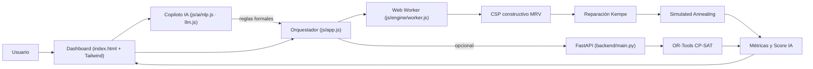

# GnoSoft Timetable AI 🧠📅

**Reto Gnosoft — Generación Inteligente y Optimización de Horarios Escolares mediante IA**

Aplicación web que genera, optimiza y ajusta en vivo el horario escolar completo de un colegio
(6°A–8°B · 180 bloques semanales) con **0 cruces duros**, un **Score IA de calidad (0–100 %)** y un
**Copiloto IA** que entiende instrucciones en español y re‑optimiza al instante.

---

## ✨ Funcionalidades

| Módulo | Descripción |
|---|---|
| **Motor híbrido (navegador)** | CSP constructivo (MRV) → reparación por cadenas de Kempe → Simulated Annealing con evaluación delta incremental. Corre en un Web Worker, en milisegundos. |
| **Motor exacto (servidor)** | Google OR‑Tools **CP‑SAT** vía FastAPI (`/api/solve`). Opcional: la app funciona 100 % sin backend. |
| **Copiloto IA** | Chat en español → restricciones formales `X[c,m,p,a,d,b] = 0` → re‑optimización con *warm start*. Parser NLP local + Gemini opcional. |
| **Dashboard** | Dark mode (Tailwind). KPIs en vivo: cruces, Score IA, horas huecas, equidad, uso de laboratorios. |
| **Triple vista** | Por curso, por docente (bloques libres, restricciones activas, carga vs. límite) y por aula. |
| **Click‑to‑swap** | Intercambio manual validado por la IA, con explicación cuando se bloquea y alternativa Kempe. |
| **Pesos en vivo** | Sliders: horas huecas, fatiga, preferencia matutina, equidad. |
| **Exportación** | CSV y PDF/impresión. |

---

## 🏗️ Arquitectura



```
├── index.html            # UI (Tailwind CDN, Lucide, Inter)
├── css/styles.css
├── data/school.json      # Datos demo: 6 cursos, 13 docentes, 11 materias, 10 espacios
├── js/
│   ├── core/             # utilidades y manejo de tiempo/bloques
│   ├── engine/           # modelo, estado incremental, CSP, Kempe, SA, métricas, explicación
│   ├── ai/               # parser NLP en español + Gemini opcional
│   ├── ui/               # KPIs, horarios, detalle, controles, chat, exportación
│   └── app.js            # orquestador
├── backend/              # FastAPI + OR-Tools CP-SAT + fitness + tests
└── tests/selftest.mjs    # pruebas del motor JS y del NLP
```

---

## 📐 Modelo matemático

Variable de decisión binaria:

```
X[c,m,p,a,d,b] = 1  si el curso c recibe la materia m con el profesor p en el aula a, día d, bloque b
```

**Restricciones duras (0 % de error)**

- Un curso a la vez: `Σ_{m,p,a} X[c,m,p,a,d,b] ≤ 1   ∀ c,d,b`
- Un docente a la vez: `Σ_{c,m,a} X[c,m,p,a,d,b] ≤ 1   ∀ p,d,b`
- Un aula a la vez y con capacidad/tipo válido: `Σ X[·,·,·,a,d,b] ≤ 1`, `cap(a) ≥ alumnos(c)`, `tipo(a) = tipo(m)`
- Intensidad horaria: `Σ_{d,b} X[c,m,·,·,d,b] = horas(c,m)`
- Disponibilidad: `X[·,·,p,·,d,b] = 0` si `p` no está disponible en `(d,b)`
- Carga máxima: `Σ X[·,·,p,·,·,·] ≤ maxHoras(p)`

**Función objetivo (blandas, ponderadas por los sliders)**

```
min  w_h·HorasHuecas + w_f·Fatiga(bloques pesados consecutivos) + w_m·(materias pesadas tarde)
     + w_e·Desequilibrio(carga diaria) + penalizaciones de reglas "evitar"
```

`Score IA = 100 · (1 − costo_blando / costo_referencia)`, con 0 si existe alguna violación dura.

---

## 🚀 Cómo ejecutar

### Opción A — Solo frontend (sin instalar nada)

```bash
python -m http.server 8080
# abrir http://localhost:8080
```

### Opción B — Frontend + CP‑SAT (FastAPI)

```bash
python -m venv .venv
# Windows
.venv\Scripts\pip install -r requirements.txt
.venv\Scripts\uvicorn backend.main:app --reload --port 8000
# Linux/Mac
.venv/bin/pip install -r requirements.txt
.venv/bin/uvicorn backend.main:app --reload --port 8000
```

Abrir http://localhost:8000 (UI) · http://localhost:8000/docs (Swagger).
En ⚙️ Configuración puedes elegir el motor (Híbrido / CP‑SAT) y añadir tu API key de Gemini (opcional).

### API

| Método | Ruta | Descripción |
|---|---|---|
| GET | `/api/health` | Estado del servidor y versión de OR‑Tools |
| GET | `/api/sample` | Datos demo |
| POST | `/api/solve` | Datos + reglas + pesos → horario optimizado + métricas |
| POST | `/api/validate` | Evalúa un horario existente (violaciones y métricas) |

---

## 🎤 Guion de demo (Copiloto IA)

Escribe en el chat (o usa los botones de sugerencias):

1. `El profesor Carlos Ruiz no puede asistir los viernes en las últimas 2 horas`
2. `La profesora Laura Méndez no está disponible los lunes a primera y segunda hora`
3. `Evitar que Matemáticas y Física se dicten en las últimas horas del día`
4. `Priorizar 0 horas huecas para todos los docentes y evitar bloques consecutivos pesados`
5. `El profesor Julián Ríos no puede dictar clase los miércoles en la tarde`

Cada instrucción muestra su formalización `X[...] = 0`, re‑optimiza y resalta las celdas que cambiaron,
manteniendo **0 cruces**.

---

## 🧪 Pruebas

```bash
node tests/selftest.mjs              # motor JS + NLP (12 corridas, 0 conflictos duros)
python -m pytest -q                  # backend (requiere dependencias instaladas)
```

Resultados de referencia: 0 conflictos duros en todas las corridas · ~400 ms promedio · Score IA ≈ 99 %.

---

## 📄 Licencia

MIT — ver [LICENSE](LICENSE).
